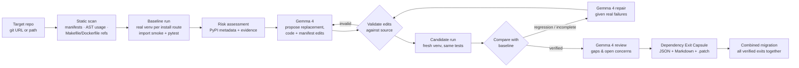

# DepExit: AI-planned, execution-verified dependency exits

**Hacktoberfest Hack Day Mumbai × ISTE KJSSE 2026 · Track 1: Gemma 4, Dependency Resilience**

DepExit is an open-source CLI. You point it at a Python repository and it:

1. finds dependencies that are at risk;
2. maps exactly where and how each one is used;
3. asks **Gemma 4** to propose a replacement and write the migration;
4. **installs and tests** the original and the migrated dependency sets side by side;
5. lets Gemma repair its own proposal using the real test failures;
6. writes a reusable **Dependency Exit Capsule** for every dependency, plus a ready-to-apply patch.

On top of that:

- 🧹 **Auto-Organizer** rebuilds `requirements*.txt` and `pyproject.toml` from evidence. It removes packages that are never used, declares imports nobody declared, sorts the files, and keeps both manifests in sync. Gemma writes a one-line `# (AI)` comment for each requirement. The organized result is then installed and tested like any other change.
- 🔮 **Python Forecast** installs and tests the *original* project on future Python versions (for example 3.13 and 3.14) and shows which dependency breaks where.
- 🌿 **Migration branch**: one click (or `depexit branch`) commits the verified migration, the organized manifests and the capsules to a new git branch in your clone, ready for a PR.
- 🖥️ **Local web dashboard** (`depexit web`) shows live progress, a risk map, each capsule with OBSERVED and AI side by side, the forecast matrix, the organizer diff, and the branch button.

Every capsule keeps two things strictly apart:
- 🔍 **OBSERVED**: facts DepExit measured itself (manifests, PyPI, AST scan, real installs, real test runs).
- 🤖 **AI**: suggestions generated by Gemma 4. These are never presented as proof.

---

## The problem statement

Open-source projects depend on packages that go stale, get deprecated, break on new Python versions, or quietly drift between manifests. Maintainers usually find out only when something breaks. An AI can suggest a replacement, but a suggestion on its own isn't trustworthy. A migration needs to be **tested** against the project's real code and tests before anyone relies on it.

## The solution



### What DepExit detects (all observed, no AI)

| Indicator | How it's measured |
|---|---|
| `import_fails` | Each dependency is imported inside the real venv on the target Python version |
| `test_failure` | Failing pytest cases whose traceback runs through the dependency |
| `deprecation_warning` | Deprecation warnings from imports and from the test run |
| `manifest_conflict` | `requirements*.txt` and `pyproject.toml` disagree, and no PyPI release satisfies both |
| `stale` / `inactive` | Age of the latest release and the development-status classifier on PyPI |
| `pinned_behind` / `yanked_pin` | Pinned version compared with the latest release |
| `undeclared` / `unused` | The code imports a package that is never declared, or declares one it never uses |
| `private_api` / `monkeypatch` | AST detects `_private` API use and runtime patching of library attributes |
| `tooling_as_runtime` | Build tools (setuptools, pip, wheel) listed as runtime dependencies |

The usage scanner handles aliases (`from requests import Session as S`), lazy imports inside functions, side-effect-only imports, and references in Makefiles, Dockerfiles and CI configs (for example `nosetests`).

### What a verdict means

| Verdict | Meaning |
|---|---|
| ✅ `verified_improvement` | Previously failing checks now pass, with no regressions |
| ✅ `verified_no_regression` | Everything that passed before still passes |
| ❌ `regression` | Some previously passing tests fail after the migration |
| ❌ `install_failed` | The new dependency set cannot be installed |
| ⚠️ `incomplete` | The old dependency is still referenced somewhere |
| ⚠️ `not_applied` | The AI's code edits did not match the source |

---

## Quick start (no commands)

1. Install **Python 3.12** (tick "Add python.exe to PATH") and **Git**.
2. Open the `tool` folder and double-click **`start-depexit.bat`** (Windows) or **`start-depexit.command`** (macOS). The first start sets everything up, which takes 2 to 3 minutes.
3. Your browser opens the DepExit dashboard. Paste your Gemma key once (tick "Remember on this computer"), choose **Quick check** or **Full analysis**, and click **Run analysis**.

Everything else, including past runs, capsules, the forecast, the organizer and creating a git branch, is done from the dashboard.

## Setup

You need **Python 3.10 or newer** and **git**. That's all. [uv](https://docs.astral.sh/uv/) is installed automatically as a dependency. It creates the test environments quickly and downloads Python 3.12, 3.13 and 3.14 by itself when they aren't installed.

**Windows (PowerShell)**
```powershell
git clone https://github.com/<you>/H26_TeamName_DepExit
cd H26_TeamName_DepExit\tool
python -m venv .venv
.venv\Scripts\activate
pip install -e .
copy ..\.env.example .env      # then put your key in .env
```

**macOS / Linux**
```bash
git clone https://github.com/<you>/H26_TeamName_DepExit
cd H26_TeamName_DepExit/tool
python3 -m venv .venv && source .venv/bin/activate
pip install -e .
cp ../.env.example .env        # then put your key in .env
```

Get a free Gemma API key from [Google AI Studio](https://aistudio.google.com/apikey) and set `GEMINI_API_KEY=...` in `tool/.env`. That file is git-ignored; never commit it. In the dashboard you can also paste the key; it is kept in memory only.

Check that everything works (offline, no key needed):
```bash
pip install pytest && pytest -q        # 10 tests, including the real Gemma SDK path against a local stand-in server
```

## Usage

```bash
# Full run against the organizer-provided repository
depexit analyze https://github.com/rishrek/LinkWatch --python 3.12

# Only some dependencies, three verify/repair rounds each
depexit analyze https://github.com/rishrek/LinkWatch --only jinja2,nose,appdirs --attempts 3

# Evidence only, no AI calls
depexit analyze ../path/to/repo --no-ai

# Also forecast future Python versions
depexit analyze https://github.com/rishrek/LinkWatch --forecast 3.13,3.14

# Commit verified migration + organized manifests + capsules to a new branch in your clone
depexit branch /path/to/your/clone --capsule capsule

# Web dashboard on http://127.0.0.1:8000 (runs locally)
depexit web
```

| Option | Default | Meaning |
|---|---|---|
| `--out` | `capsule` | Output directory |
| `--python` | `3.12` | Python used for the test venvs |
| `--only` | – | Comma-separated dependencies to plan exits for |
| `--min-score` | `2` | Minimum risk score that gets an exit plan |
| `--max-deps` | `8` | Cap on the number of migrations per run |
| `--attempts` | `2` | Verify → repair rounds per dependency |
| `--model` | `gemma-4-26b-a4b-it` | Gemma model id (or set `$GEMMA_MODEL`) |
| `--no-ai` | off | Skip Gemma and produce observed evidence only |
| `--forecast` | – | Extra Python versions to forecast, e.g. `3.13,3.14` |
| `--no-organize` | off | Skip the Auto-Organizer |

### Output

```
capsule/
  README.md                  report: baseline, every dependency, verdicts
  capsule.json               machine-readable index
  dependencies/<dep>.md      human-readable Dependency Exit Capsule
  dependencies/<dep>.json    machine-readable capsule (schema dependency-exit-capsule/1.0)
  dependencies/<dep>.patch   the verified migration, ready for `git apply`
  combined-migration.patch   all verified exits applied together
  organizer.patch            organized manifests (applies on top of the migration)
  ai_calls.json              every Gemma call: purpose, prompt hash, latency, raw response
```

Each capsule contains: dependency details, risk indicators, usage locations, the proposed replacement, migration steps, suggested tests, executed test results, compatibility gaps, and open concerns and limitations.

---

## Architecture

| Module | Responsibility | AI? |
|---|---|---|
| `manifest.py` | Parse `requirements*.txt` and `pyproject.toml` (runtime, dev, extras, build) with file and line numbers | no |
| `usage.py` | AST usage finder (aliases, lazy imports, private API, monkeypatching) and non-Python references | no |
| `pypi.py` | Live metadata from the PyPI JSON API; checks whether conflicting specs can be satisfied | no |
| `env.py` | Isolated venvs per install route, import smoke tests, pytest with JUnit parsing | no |
| `risk.py` | Turns observations into scored indicators | no |
| `gemma.py` | Gemma 4: **propose**, **repair** (from validation or test failures), **review** | **yes** |
| `migrate.py` | Validates and applies AI edits to a throw-away copy; manifest rewriting; diffs | no |
| `pipeline.py` | Orchestration, before/after comparison, verdicts, combined migration, Python forecast | no |
| `organizer.py` | Auto-Organizer: rule-based manifest rebuild; Gemma writes the `(AI)` comments | comments only |
| `gitbranch.py` | Commits the verified patches and capsules to a new local branch (never pushes) | no |
| `web.py`, `static/index.html` | Local dashboard (stdlib HTTP server, no cloud) | no |
| `capsule.py` | Writes the JSON and Markdown capsules with OBSERVED and AI sections | no |

The target repository is never modified. All work happens in copies under `.depexit-work/`.

## Dependencies

| Package | Why | License |
|---|---|---|
| [google-genai](https://pypi.org/project/google-genai/) | Official SDK for calling Gemma 4 through the Gemini API | Apache-2.0 |
| [packaging](https://pypi.org/project/packaging/) | Parsing requirement specifiers and versions | Apache-2.0 / BSD |
| [rich](https://pypi.org/project/rich/) | Console output | MIT |
| [uv](https://github.com/astral-sh/uv) (optional, external) | Fast venv creation and installs | MIT / Apache-2.0 |
| pytest (installed into target venvs) | Runs the target's tests | MIT |

## AI model details

| Field | Value |
|---|---|
| Model name | Gemma 4 |
| Model version | `gemma-4-26b-a4b-it` (instruction-tuned, 26B MoE, ~4B active); configurable, e.g. `gemma-4-31b-it` |
| Model source | Google DeepMind, open weights |
| Access method | Gemini API via Google AI Studio (free tier), `google-genai` Python SDK |
| License / terms | Gemma 4 weights under Apache 2.0; API use subject to the Gemini API Terms of Service |
| Role in the project | (0) Write the one-line purpose comment for each requirement in the Auto-Organizer, marked `(AI)`. (1) Choose a replacement and write the concrete migration: code edits as exact find/replace, plus manifest changes. (2) Repair its own proposal when DepExit reports validation errors, regressions, or leftover references. (3) Review the observed before/after evidence and list compatibility gaps, unresolved risks and extra tests. Gemma never decides the verdict. Verdicts come only from executed installs and tests. |

**AI usage disclosure:** Gemma 4 is a runtime component of DepExit as described above. AI coding assistants were also used during development (the hackathon rules allow this). All generated code was reviewed and tested by the team. The repo includes unit tests in `tool/tests/`.

## Known limitations

- Verification is only as strong as the target's own test suite. Code paths with no tests are not proven equivalent; the capsule says so when no test touches the dependency.
- Static analysis misses dynamic imports (`importlib.import_module("x")`, plugin entry points).
- Python-only (pip / pyproject ecosystems). Only the requirements-file and pyproject install routes are verified; Docker images and other OSes are not.
- Each dependency is migrated against the original baseline. The combined run checks that the exits work together, but patches that overlap in the same file can conflict.
- Windows line endings: target repos are cloned with `core.autocrlf=false`, and branches are built through the git index, so CRLF checkouts are handled.
- Large repositories send a truncated set of files to Gemma (about 26k characters of context per dependency).
- The quality of AI proposals depends on the model. A wrong proposal shows up as `regression`, `incomplete` or `not_applied` rather than being hidden.
- Security vulnerabilities are out of scope for this edition.

## Running DepExit's own tests

```bash
cd tool && pip install pytest && pytest -q
```

The tests cover the AST usage scanner, manifest parsing, migration and validation (including whitespace-tolerant matching), the Auto-Organizer, risk rules, and the **real google-genai SDK request path**, using a local stand-in server that also forces the plain-prompt fallback.

## Repository layout

This repository is a fork of the organizer's starter repo, [LinkWatch](https://github.com/rishrek/LinkWatch). LinkWatch's original files stay untouched at the root (its README is in `LINKWATCH_README.md`). DepExit lives in `tool/`, which contains a `.depexit-ignore` marker so DepExit never analyses its own code when pointed at this fork.

## License

MIT. DepExit is licensed under [tool/LICENSE](tool/LICENSE); the original LinkWatch code keeps its own MIT [LICENSE](LICENSE).
